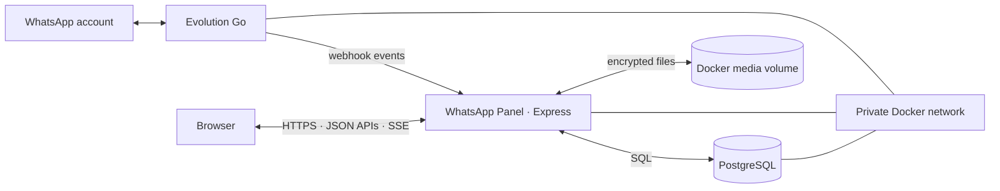

# WhatsApp Panel

<p align="center">
  <strong>A private, self-hosted inbox for WhatsApp, powered by Evolution Go.</strong><br />
  Manage chats, reply in context, share media, and keep conversations updated in real time.
</p>

<p align="center">
  
  
  
  
</p>

**WhatsApp Panel** is a single-administrator web application that connects to [Evolution Go](https://github.com/EvolutionAPI/evolution-go) and presents WhatsApp conversations in a familiar, browser-based interface. It is designed to be self-hosted: the panel, database, and media storage run on infrastructure you control.

> This is an independent project and is not affiliated with, endorsed by, or sponsored by WhatsApp or Meta.

## At a glance

- Connect and manage one or more WhatsApp instances through Evolution Go.
- Read and send messages in one-to-one chats and groups.
- Receive updates through Evolution Go webhooks and stream them to open browsers in real time.
- Reply to a specific message, react with emoji, forward messages, and share files.
- Send a formatted Telegram alert for every newly received WhatsApp message, including its media when available.
- Browse contact details, phone numbers, avatars, group names, and available participant information.
- Store message content, API credentials, and uploaded media encrypted at rest.
- Protect the web app with a one-time setup flow, a strong administrator password, secure sessions, and HTTPS.

## Features

| Area | What it does |
| --- | --- |
| **Instances** | Create and select Evolution Go instances, pair a WhatsApp account with a QR code, refresh an expired QR code, and follow connection status. |
| **Chats** | Search conversations, start a chat by phone number, distinguish groups from direct chats, and open contact or group information. |
| **Messaging** | Send text, upload and send media, play or download audio, forward a message, and use emoji from the built-in searchable picker. |
| **Replies** | Select **Reply** from a message's context menu. The panel shows a quoted preview and sends the reply reference to WhatsApp when the configured Evolution Go build supports it. |
| **Reactions** | Add or remove emoji reactions and see reaction counts and whether your own account reacted. |
| **Message changes** | Show earlier message content and deletion state when Evolution Go sends the corresponding update or revoke event to the webhook. |
| **Live updates** | Receive webhook events, persist them, and broadcast changes to authenticated browser sessions over Server-Sent Events (SSE). |
| **Telegram alerts** | Send a structured notification for each newly received message, with sender, phone when available, group, text, and supported attachments. Outbox retries handle temporary Telegram errors without delaying the WhatsApp webhook. |
| **Contacts and groups** | Display chat titles, profile pictures, phone numbers, and participant information when the connected API provides those fields. |

### Message history and event limits

The panel is event-driven. It saves messages and changes delivered by Evolution Go webhooks and any synchronization events the API provides. It does not import an arbitrary, complete history from WhatsApp. If old messages were never delivered to this installation, the panel cannot reconstruct them. Likewise, an edit or deletion can only be preserved when its event reaches the panel.

## How it works



1. An administrator creates an instance in the panel. The backend asks Evolution Go to create and connect it, then the administrator scans its QR code with WhatsApp.
2. Evolution Go calls the panel's per-instance webhook as messages, connection changes, reactions, and supported message updates arrive.
3. The backend validates the webhook token, stores relevant data, and emits an event through an authenticated SSE connection. The browser updates the chat list or open conversation without polling the page.
4. When the administrator sends or reacts to a message, the browser calls an authenticated panel API. The backend calls Evolution Go using the instance's API credential.

The panel's HTTP API and the Evolution Go API communicate over a private Docker network. Caddy is the public HTTPS entry point and proxies browser traffic to the panel.

## Technology stack

| Layer | Technology | Role |
| --- | --- | --- |
| Frontend | HTML, CSS, vanilla JavaScript | Responsive chat interface, contact drawer, media controls, emoji picker, and SSE updates. No frontend framework or build step is required. |
| Backend | Node.js 24+, Express 5 | Authenticated JSON endpoints, webhook processing, Evolution Go integration, media handling, and SSE. |
| Database | PostgreSQL, `pg` | Administrators, sessions, instances, chats, messages, reactions, reply metadata, edits, and event records. |
| WhatsApp connection | Evolution Go | Instance creation, QR pairing, connection management, message delivery, and webhook events. |
| Notifications | Telegram Bot API | Deliver formatted message alerts and supported media to a configured private group. |
| Edge proxy | Caddy 2 | HTTPS certificates, TLS termination, response security headers, and reverse proxying. |
| Containers | Docker and Docker Compose | Isolated deployment, health checks, persistent media, and container hardening. |
| Cryptography | Node.js `crypto` | scrypt password derivation, SHA-256 token hashes, and AES-256-GCM encryption for stored content and files. |
| UI data | Emoji data under Apache-2.0 | Searchable emoji catalog and categories, with its license included in `public/EMOJI-DATA-LICENSE.txt`. |

### Main dependencies

- [`express`](https://www.npmjs.com/package/express) — HTTP server and API routes.
- [`helmet`](https://www.npmjs.com/package/helmet) — HTTP security headers and Content Security Policy.
- [`express-rate-limit`](https://www.npmjs.com/package/express-rate-limit) — rate limits on setup and login endpoints.
- [`pg`](https://www.npmjs.com/package/pg) — PostgreSQL client.
- [`multer`](https://www.npmjs.com/package/multer) — bounded multipart upload handling.
- [`qrcode`](https://www.npmjs.com/package/qrcode) — QR rendering for instance pairing.

See `package.json` and `package-lock.json` for the complete, locked dependency list.

## Security

Security is built into the application and deployment configuration:

- There is no public registration page. The initial administrator is created through a random, single-use setup token that expires after 24 hours.
- Passwords are derived with scrypt; session identifiers and setup/webhook tokens are stored as hashes rather than plaintext.
- Login and setup attempts are rate limited. Authenticated state-changing requests require CSRF protection; cookies are configured for secure use behind HTTPS.
- The API requires an authenticated session except for the health check and the individually token-protected Evolution Go webhook.
- Message payloads, webhook event bodies, instance API tokens, QR data, and uploaded media are encrypted with AES-256-GCM using `APP_ENCRYPTION_KEY`.
- Docker runs the panel as an unprivileged user with a read-only root filesystem, dropped Linux capabilities, a restricted `/tmp`, and `no-new-privileges`.
- Caddy adds browser security headers and does not expose internal media and webhook routes as general public endpoints.
- Runtime secrets belong in ignored, permission-restricted files, never in Git, screenshots, issue reports, or public logs.
- Telegram bot tokens and destination chat IDs are kept only in protected server runtime configuration. Alert text and attachments are shared with every member who can read the configured Telegram group.

**Encryption key warning:** `APP_ENCRYPTION_KEY` is required to decrypt stored content and media. Keep a protected backup of this key separately from the database and media backups. Losing it makes encrypted data unrecoverable; exposing it compromises that data.

These safeguards reduce risk but do not replace server patching, access control, secure backups, network configuration, and review of changes before deployment.

## Requirements

### Local development

- Node.js 24 or newer and npm.
- PostgreSQL reachable from the development machine.
- A reachable Evolution Go instance and API key for integration work.
- A 32-byte encryption key, represented as 64 hexadecimal characters.

### Docker deployment

- A Linux server with Docker Engine and the Docker Compose plugin.
- An existing Evolution Go deployment with PostgreSQL on a Docker network accessible to this panel. The default Compose configuration expects the network `evolution-go_default`, a service reachable as `evolution-go:8080`, and the PostgreSQL container `evolution-go-postgres`.
- A DNS name pointing to the server. Allow inbound TCP ports 80 and 443; Caddy obtains and renews HTTPS certificates for the configured name.
- For the provided Windows deployment scripts: PowerShell, OpenSSH (`ssh`/`scp`), and a key accepted by the remote server.

## Run locally

1. Install dependencies:

   ```bash
   npm ci
   ```

2. Copy `.env.example` to a **local-only** environment file such as `.runtime.env`. Set real values for `DATABASE_URL`, `EVOLUTION_URL`, `EVOLUTION_API_KEY`, and `APP_ENCRYPTION_KEY`. Keep `.runtime.env` out of Git; it is ignored by `.gitignore`.

   To generate an encryption key locally:

   ```bash
   node -e "console.log(require('node:crypto').randomBytes(32).toString('hex'))"
   ```

3. Start the server using that environment file:

   ```powershell
   $env:ENV_FILE = ".runtime.env"
   npm start
   ```

4. Open `http://localhost:3000`. For the first account, create a one-time setup token with `npm run bootstrap:token` while `ENV_FILE` points to the same configuration. Open `http://localhost:3000/#setup=YOUR_ONE_TIME_TOKEN` and follow the setup form. Use a unique password of at least 14 characters.

For a local setup, configure Evolution Go to send webhooks to a URL reachable from its runtime. A containerized Evolution Go service cannot call the developer machine's `localhost` address unless the development network explicitly routes it there.

## Deploy to a server

The repository includes a deployment flow for an existing Evolution Go installation. It archives the current committed `HEAD`, uploads the archive over SSH, prepares protected runtime settings on the server, and builds/starts the panel and Caddy containers.

1. Configure and verify Evolution Go on the server first. The preparation script reads its `GLOBAL_API_KEY` from the server-side Evolution Go `.env`; it does not print the key.
2. Commit the reviewed application changes. The deployment script publishes **the commit at `HEAD`**, not uncommitted working-tree changes.
3. From PowerShell, run the deployment script with your own server address, Linux account, and HTTPS URL:

   ```powershell
   .\scripts\deploy.ps1 `
     -TargetHost "YOUR_SERVER_HOST" `
     -RemoteUser "YOUR_LINUX_USER" `
     -PublicUrl "https://panel.example.com" `
     -SshKey "$env:USERPROFILE\.ssh\id_ed25519"
   ```

   The script expects the remote account's home directory to contain the existing Evolution Go deployment at `~/evolution-go-deploy`. The panel source is deployed to `~/whatsapp-panel`. Adjust these paths in the scripts if your server uses a different layout.

4. Once the service is healthy, generate the first administrator setup token on the server:

   ```bash
   cd ~/whatsapp-panel
   docker compose exec -T panel npm run bootstrap:token
   ```

   Open `https://panel.example.com/#setup=YOUR_ONE_TIME_TOKEN`, create the administrator, and save the password in a password manager. The token is single-use and expires after 24 hours.

### Telegram notifications

1. Add the bot to the destination Telegram group and allow it to send messages.
2. Configure `TELEGRAM_BOT_TOKEN` and `TELEGRAM_CHAT_ID` in the server's protected `.runtime.env` using the SSH helper. The token is read from a local file and sent over SSH standard input; it is never committed or passed as a command-line argument.

   ```bash
   .\scripts\configure-telegram.ps1 `
     -TargetHost "YOUR_SERVER_HOST" `
     -RemoteUser "YOUR_LINUX_USER" `
     -BotTokenFile "PATH_TO_BOT_TOKEN_FILE" `
     -ChatId "YOUR_TELEGRAM_GROUP_ID" `
     -SshKey "$env:USERPROFILE\.ssh\id_ed25519"
   ```

3. Send a synthetic test notification to confirm that the bot can post to the group:

   ```powershell
   .\scripts\test-telegram.ps1 `
     -BotTokenFile "PATH_TO_BOT_TOKEN_FILE" `
     -ChatId "YOUR_TELEGRAM_GROUP_ID"
   ```

   Incoming WhatsApp messages are queued after the database transaction commits; duplicate events, outgoing messages, edits, deletions, and reactions do not create extra alerts. A worker retries temporary Telegram failures. Photos, audio, video, and documents are attached when Evolution Go delivered their media to the panel; if Telegram rejects a file permanently, the text alert still indicates the attachment.

5. Check container health and visit `/healthz` over the configured HTTPS URL. The health endpoint indicates application/database readiness; it does not prove WhatsApp is connected.

The first server preparation creates a dedicated database role/database, generates an encryption key and database password, and writes protected runtime files. Subsequent runs leave existing runtime files unchanged. Keep those files private and back them up securely.

### Native WhatsApp quoted replies

The app includes a deployment helper for a pinned Evolution Go source revision with a small patch that sends quoted-message metadata correctly. The patch builds a custom image tagged `whatsapp-panel/evolution-go:0.7.3-reply1` and replaces the Evolution Go service when the helper is run. It requires the same SSH target parameters:

```powershell
.\scripts\deploy-evolution-go-reply-fix.ps1 `
  -TargetHost "YOUR_SERVER_HOST" `
  -RemoteUser "YOUR_LINUX_USER" `
  -SshKey "$env:USERPROFILE\.ssh\id_ed25519"
```

This operation restarts the Evolution Go container. Review `deploy/evolution-go/evolution-go.patch` and the pinned source revision before using the helper. Without a compatible Evolution Go build, the panel may still show its local reply preview, but WhatsApp recipients may receive the sent text as a regular message without a native quote.

## Backups and recovery

Back up all of the following together:

- The `whatsapp_panel` PostgreSQL database.
- The `panel_media` Docker volume.
- The protected runtime file containing `APP_ENCRYPTION_KEY` and database/API connection settings.

Encrypt backups with a separate backup key, restrict access, and periodically test restoring into an isolated environment. A database or media backup without the matching application encryption key cannot restore readable content. See `scripts/backup-notes.sh` for a reminder of the required data.

## Repository map

```text
.
├── deploy/evolution-go/      # Pinned Evolution Go build and quoted-reply patch
├── public/                   # Browser app, styles, emoji dataset and its license
├── scripts/                  # Deployment, Telegram setup, server preparation and backup notes
├── src/
│   ├── bootstrap.js          # One-time administrator setup token generator
│   └── server.js             # Express APIs, persistence, webhooks and SSE
├── .env.example              # Non-secret configuration template
├── Caddyfile                 # HTTPS proxy and security headers
├── compose.yaml              # Hardened panel and proxy services
├── Dockerfile                # Reproducible production container
└── package.json              # Commands and runtime dependencies
```

## Useful commands

```bash
npm ci                 # Install the locked dependencies
npm run check          # Check JavaScript syntax
npm start              # Start the HTTP server
npm run bootstrap:token # Create an initial-admin setup token
docker compose ps      # Inspect deployment containers
```

## Known limits

- This is a private operations panel, not a complete replacement for every WhatsApp or WhatsApp Web feature.
- Historical messages are limited to what Evolution Go delivers to the panel; there is no full-history import.
- Contact, group, participant, and profile photo details depend on fields and events provided by Evolution Go and the linked WhatsApp account.
- Edit and deletion history is available only when the integration emits those events while the panel can receive them.
- Native quoted replies require the compatible Evolution Go patch described above.
- The current authentication model is a single administrator account; there are no team roles or public sign-up.

## License and third-party notices

The repository does not currently declare a license for the WhatsApp Panel application code. Unless and until a project license is added, no license to reuse or redistribute that application code is granted. The bundled emoji dataset has its own Apache License 2.0 terms, included in `public/EMOJI-DATA-LICENSE.txt`.

Evolution Go is a separate project and is distributed under its own terms. See its upstream repository for source, notices, and license details.
